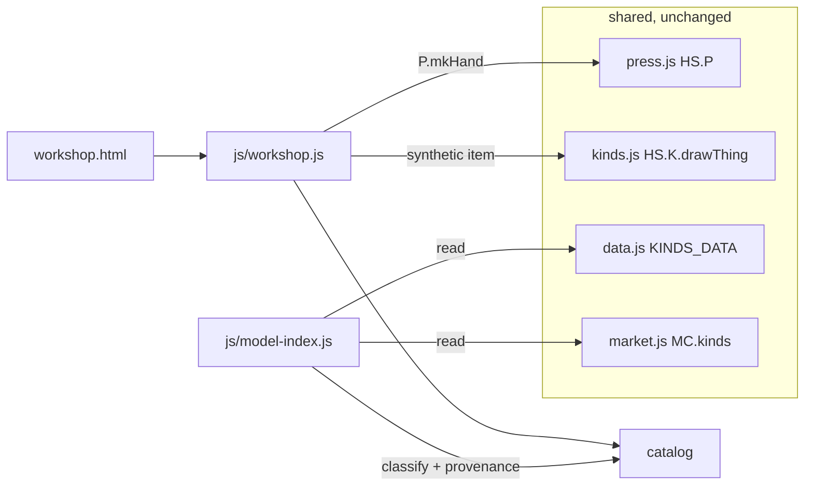

# Object Workshop — Candidate B: dedicated catalog/editor route

Status: design sketch. Read-only; no code changed.
Companion: `object-workshop.todo.md` (which selected Candidate A, an in-game drawer,
and rejected Candidate B). This sketch proposes B properly and answers the reason
it was rejected: "duplicates navigation and requires a second render/data-loading path."

## Goal

Browse the objects already in the market, inspect their procedural model code, tweak
them, and follow a link to the true source. The market "3D models" are procedural shape
lists in `web/js/market.js`, drawn by `web/js/kinds.js`. Candidate B is a separate
catalog/editor page instead of an in-game drawer.

## The one fact the design turns on

There are **no mesh files** in this repo. No `.glb`, `.gltf`, or `.obj` exist. A "3D
model" here is a data object with a `shapes` array of primitives, interpreted by
`kinds.js`. Two render paths exist and must be told apart:

1. **Procedural** — `HS.K.drawThing` → `PRIM` (box, legs, cyl, cone, ball, pole, panel,
   plant, books, flat, glow, lines, dot). Fully in the shape data. Fully tweakable.
2. **Textured / image-backed** — a `panel` shape carries `image: 'item'` (or a key),
   which `kinds.js` draws from `c.images`, loaded by `loadImages()` in `market-app.js`.
   The appearance is partly an external bitmap, so it is not fully editable here.
   Example: the `art` kind in `data.js` uses `"image":"item"`, and placed items carry
   `image`, `url`, `source`, `store`, `artist`.

So "external mesh" in this codebase means the **image-backed** path, and the "true
source" link means either (a) the file+line of a procedural definition, or (b) the
external `url` of an image-backed art item. The workshop must classify and limit editing
by path.

## Architecture



### New files (all additive)

- `web/workshop.html` — catalog/editor route. Loads the shared scripts it needs
  (`data.js`, `market.js`, `kinds.js`, `press.js`, `world.js`, `scene.js`). Does **not**
  load `market-app.js`, `heist.js`, `detection.js`, `bt.js`, `guard_config.js`,
  `navpath.js`, `robot.js` — no game state is constructed.
- `web/workshop.css` — page styles; reuses the CSS variables in `style.css`
  (`--paper`, `--ink`, `--card`, `--sun`, `--teal`, `--coral`).
- `web/js/model-index.js` — pure, DOM-free. Builds the catalog and provenance.
- `web/js/workshop.js` — the editor app: browser UI, preview, tweaks, source links.

### Why this is not a duplicated render path

The renderer is already page-agnostic. `market-app.js` is a game controller that calls
`HS.K.drawThing`; the workshop is a viewer that calls the **same** `HS.K.drawThing`. The
only new rendering code is a single-model viewport helper (fit, pan, zoom, face), not a
reimplementation of shape drawing. `model-index.js` is read-only and pure, so it cannot
mutate heist state or the source definitions.

### model-index.js contract

```js
// returns { catalog, provenance, classify }
// catalog: [{ name, label, source, place, size, height, colors, options,
//             shapeCount, imageBacked, imageUrl, imageAsset, store, artist }]
// provenance: { [kindName]: { file: 'js/market.js'|'js/data.js', line: n } }
```

Provenance is self-indexing: fetch `js/market.js` and `js/data.js` as text at boot and
match `'<name>':` / `"<name>":` to a line number. This powers both the source-link card
and an in-tool source viewer (no separate build step). Fallback is filename only.

### Classifier

```js
function classify(kind, items) {
  const usesImage = (kind.shapes || []).some((s) => s.image);
  const anyItem = items.some((it) => it.kind === kind.name && (it.image || it.url));
  if (usesImage || anyItem) return 'image-backed';
  if ((kind.shapes || []).some((s) => JSON.stringify(s).includes('$'))) return 'procedural-options';
  return 'procedural';
}
```

- `procedural` → full shape editor enabled.
- `procedural-options` → shape editor plus option-variable controls (e.g. plant `style`).
- `image-backed` → placement/color editing only; true source = the item `url`.

## State shape

```js
const WS = {
  catalog: null,                 // immutable index from model-index.js
  query: '', filter: 'all',      // 'all' | 'procedural' | 'image-backed' | 'market' | 'house'
  selected: null,                // selected kind name
  draft: null,                   // deep clone of the selected kind (working copy)
  view: { zoom: 1, x: 0, y: 0, face: 'ne', autoFit: true },
  snippet: '', dirtyCount: 0,
};
```

`draft` keeps the `Kind` schema from `market.js`/`kinds.js` exactly, so it stays valid
for `HS.K.drawThing`. Editing is two-level, both reusing `resolve()` semantics:

- **Overlay edit** (safe, no shape mutation): `size`, `height`, `colors`, `options`,
  `place`, `against`, `face`. Serialized as an **item override** — the shape of `item`
  that `drawThing` already accepts: `{ id, kind, at, size, colors, options }`.
- **Shape edit** (advanced): mutate `draft.shapes` (add/remove/reorder/duplicate, edit
  numbers, flags). Serialized as a **kind override**: the full
  `{ ...kind, shapes, colors, size, height, reach }`.

Both produce copyable JSON. No writes back to `market.js`.

## Preview path

Single `<canvas id="preview">`. On select, build a synthetic item and draw through the
shared interpreter:

```js
const item = { id: 'ws-preview', kind: draft.name,
               at: { i: 0, j: 0, z: 0, face: WS.view.face }, ...overlay };
const box = HS.K.screenBox(draft, item);           // fit
const H = HS.P.mkHand(ctx, { seed: 1 });
HS.K.drawThing(H, HS.P.streamOf('item', 'ws-preview'), draft, item, images);
```

- **Rotation** uses the engine-supported mechanism only: the item `face`
  (`ne`/`nw`/`se`/`sw`) drives `placer`/`backToFront`. No fake 3D orbit that the game
  renderer cannot reproduce.
- **Zoom** via canvas scale; **pan** via drag; **auto-fit** from `screenBox`.
- **Deterministic**: a stable synthetic `id` keeps `streamOf`-seeded primitives
  (`plant`, `books`, `abstract`) identical across re-renders.
- Image-backed kinds: load `item.image` through a local `images` map (same one-shot
  `Image` loading as `market-app.js`, scoped to the workshop), then `drawThing` handles
  the bitmap.

## Tweak controls

Inspector accordions (left rail = catalog + filter, right = preview + inspector):

1. **Identity** — label, slug (read-only), provenance badge (market / house).
2. **Source** — file + line, "Copy path", "Open in viewer" (same-origin text viewer with
   the kind highlighted), and for image-backed art the external `url` (see safety below).
3. **Placement** — size W/D (step 0.05), height, `place`, `against`, face.
4. **Colors** — one row per `colors` slot: a `<select>` over `HS.K.SWATCH` names with a
   live riso chip (render the mix to a tiny canvas), plus "reset to default".
5. **Options** — one control per `options` key (e.g. plant `style`, `pattern`).
6. **Shapes** — ordered list; per row: primitive name, numeric fields (`<input
   type=number>`), color slot, flags (`shadow`/`soft`/`open`/`top`); actions:
   duplicate, delete, move up/down, add primitive. Numeric fields clamped to tile bounds.
7. **Output** — "Copy overlay snippet" and "Copy full kind", plus "Reset" (restore base
   kind) and a "N changes" diff badge.

Every tweak mutates `draft` and re-renders immediately. No sprite cache, no game state.

## Safe source-link behavior

- Parse every URL with `new URL(...)` and allow only `http:` / `https:` and same-origin
  relative paths. Never emit a raw `url` into `href` unchecked. Reject
  `javascript:` / `data:`.
- **File/source links** (procedural): primary action is the in-tool source viewer and
  "Copy path". Do not navigate away.
- **External art links** (image-backed): open in a new tab with `target="_blank"`
  `rel="noopener noreferrer"`, behind a one-click confirm ("This opens the artist's page
  at artic.edu — Continue?").
- Render all source text as `textContent`, never `innerHTML` (the source is untrusted
  text; escape tags, quotes, script).
- Never follow a link silently; never let a `url` field drive navigation without the
  scheme allowlist and confirm.

## Procedural vs external mesh — the explicit distinction

- Repo contains no mesh files. State this in the UI ("Procedural model · 34 shapes") so
  the user is not misled into expecting editable vertices.
- Show a badge per model: `procedural`, `procedural-options`, or `image-backed`.
- Gate the shape editor on the badge. `image-backed` shows placement/colors only and a
  "true source" link to the item `url`; `procedural` shows the definition source link to
  `market.js`/`data.js`.

## Responsive UI

- **Desktop (≥1000px)**: two-pane grid — 320px catalog rail + flexible preview/inspector.
- **Tablet (640–999px)**: catalog becomes a horizontal scroll strip; preview above the
  inspector, inspector in one scroll column.
- **Phone (<640px)**: single column; preview pinned top (16:10); catalog as a top filter
  bar + bottom-sheet list; full-width accordions; inputs ≥44px touch targets with
  `inputmode="decimal"`; pinch-to-zoom on the preview plus +/− buttons.
- `prefers-reduced-motion`: no pan/zoom tweens, instant re-render.
- Dark mode follows the existing `color-scheme` / CSS variables.

## Scope and non-goals

- In scope: browse, inspect code, tweak in a local draft, copy a snippet, follow a safe
  source link.
- Out of scope: persisting edits back to `market.js`, mutating heist state or collision,
  saving source changes. A "copy full kind → paste into `market.js`" workflow is a
  possible follow-up, not part of this route.

## Why B now, against the recorded rejection

The rejection claimed B "duplicates navigation and requires a second render/data-loading
path." This design removes both objections: the render path is the single shared
`HS.K.drawThing` with only a thin viewport helper added, and navigation is one link in
the existing top nav (which already carries "← The Heist at Dither's House"). A dedicated
route is the correct home for a catalog because the live game page is already dense
(HUD, telemetry, journal, break-UI drawer) and coupling an editor to live heist state is
exactly what the grounding warns against.
