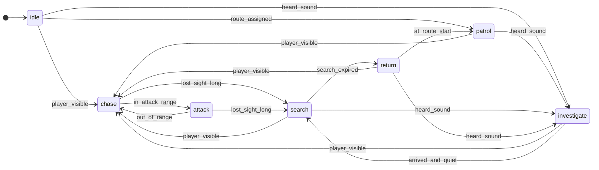

# Architectural Comparison Report: Finite State Machine vs. Behavior Tree (Project 2)

## 1. Executive Summary

This report compares the two classical AI architectures implemented for **Project 2 (Smart NPC Behavior System)**:

1. **Table-Driven 7-State Finite State Machine (`src/npc/ai/fsm.py`)** backed by a 1-token Place/Transition Petri net (`src/npc/formal/net.py`) and TLA+ specification (`src/npc/formal/tla/Guard.tla`).
2. **Hierarchical Reactive Behavior Tree (`src/npc/ai/bt.py` and `web/js/bt.js`)** built from `ReactiveSelector`, `Selector`, `Sequence`, `Condition`, and `ActionNode` primitives with explicit `.abort()` preemption hooks.

Both controllers consume the same redacted `Percepts` snapshot (`src/npc/sim/perception.py`) and emit the same `Intent` value object (`src/npc/sim/contracts.py`). Across **240 seeded episodes (52,800 ticks)** spanning four guard personalities (`Standard`, `Aggressive`, `Cautious`, `Observant`), the two architectures achieve **100.0% state-trace equivalence** while exhibiting distinct engineering tradeoffs in tick cost, structural size, and extensibility.

---

## 2. Diagrams

### 2.1 Finite State Machine Diagram (7 States, 17 Priority-Ordered Rules)

Rendered from `docs/diagrams/fsm.mmd` (`docs/diagrams/fsm.svg` / `docs/diagrams/fsm.png`), generated directly from `FSM_TABLE`:

### 2.2 Behavior Tree Diagram (21 Nodes, Priority Preemption Left-to-Right)

Rendered from `docs/diagrams/bt.mmd` (`docs/diagrams/bt.svg` / `docs/diagrams/bt.png`), generated by walking `make_guard_bt()`:

```mermaid
flowchart TD
    n1_root_selector{"? ReactiveSelector\nroot_selector"}
    n2_seq_attack["-> Sequence [P1]\nseq_attack"]
    n1_root_selector --> n2_seq_attack
    n3_cond_visible(["Cond: cond_visible"])
    n2_seq_attack --> n3_cond_visible
    n4_cond_in_range(["Cond: cond_in_range"])
    n2_seq_attack --> n4_cond_in_range
    n5_attack[/"Act: attack"/]
    n2_seq_attack --> n5_attack
    n6_seq_chase["-> Sequence [P2]\nseq_chase"]
    n1_root_selector --> n6_seq_chase
    n7_cond_visible_or_pursuing(["Cond: cond_visible_or_pursuing"])
    n6_seq_chase --> n7_cond_visible_or_pursuing
    n8_chase[/"Act: chase"/]
    n6_seq_chase --> n8_chase
    n9_seq_investigate["-> Sequence [P3]\nseq_investigate"]
    n1_root_selector --> n9_seq_investigate
    n10_cond_heard_sound(["Cond: cond_heard_sound"])
    n9_seq_investigate --> n10_cond_heard_sound
    n11_investigate[/"Act: investigate"/]
    n9_seq_investigate --> n11_investigate
    n12_seq_search["-> Sequence [P4]\nseq_search"]
    n1_root_selector --> n12_seq_search
    n13_cond_lost_or_arrived(["Cond: cond_lost_or_arrived"])
    n12_seq_search --> n13_cond_lost_or_arrived
    n14_search[/"Act: search"/]
    n12_seq_search --> n14_search
    n15_seq_return["-> Sequence [P5]\nseq_return"]
    n1_root_selector --> n15_seq_return
    n16_cond_search_expired(["Cond: cond_search_expired"])
    n15_seq_return --> n16_cond_search_expired
    n17_return[/"Act: return"/]
    n15_seq_return --> n17_return
    n18_seq_patrol["-> Sequence [P6]\nseq_patrol"]
    n1_root_selector --> n18_seq_patrol
    n19_cond_route_assigned(["Cond: cond_route_assigned"])
    n18_seq_patrol --> n19_cond_route_assigned
    n20_patrol[/"Act: patrol"/]
    n18_seq_patrol --> n20_patrol
    n21_idle[/"Act: idle"/]
    n1_root_selector --> n21_idle
```

---

## 3. Quantitative Comparison: Complexity, Readability, Extensibility, and Performance

All numbers below are produced by `/usr/bin/python3 src/npc/experiments/run.py` and stored in `experiments/summary.json` and `experiments/results.csv`.

### 3.1 Structural Complexity & Readability

| Metric | 7-State FSM (`fsm.py`) | Reactive Behavior Tree (`bt.py`) | Interpretation |
|---|---:|---:|---|
| Non-empty lines of code (LOC) | **155** | **322** | FSM is 2.1× more compact for a 7-state specification. |
| AST node count | **1,294** | **2,301** | BT requires composite node classes (`Sequence`, `Selector`, `ReactiveSelector`, `Blackboard`). |
| Cyclomatic branch points | **40** | **46** | Similar decision density; BT spreads branches across reusable node classes. |
| Primary structural units | **7 states, 17 rules** | **21 tree nodes (7 branches)** | FSM encodes control as a directed graph; BT encodes control as a priority tree. |
| Duplicated preemption arcs | **5 `player_visible` arcs, 4 `heard_sound` arcs** | **1 `seq_chase` branch, 1 `seq_investigate` branch** | In an FSM, high-priority interrupts must be wired from every preemptable source state. In a `ReactiveSelector` BT, priority order handles preemption once. |

**Readability verdict:**
- For **small state spaces ($|S| \le 7$)**, the declarative `FSM_TABLE` is easier to audit at a glance and maps 1-to-1 to formal Place/Transition Petri nets and TLA+ actions.
- As **interrupts multiply**, FSM readability degrades because every new interrupt adds $O(|S|)$ transition rows (`idle -> chase`, `patrol -> chase`, `investigate -> chase`, `search -> chase`, `return -> chase`). The Behavior Tree places `seq_attack` and `seq_chase` at the left of `ReactiveSelector` once, making priority order self-documenting.

### 3.2 Runtime Performance (52,800 Ticks across 240 Episodes)

| Guard Personality | Architecture | Episodes | State-Trace Agreement | Catch Rate (%) | Mean Detect Tick | Mean Transitions | Mean Tick Cost (µs) | p95 Tick Cost (µs) |
|---|---|---:|---:|---:|---:|---:|---:|---:|
| **Standard** (5.4t FOV, 0.25 alert gate) | **FSM** | 30 | 100.0% | 30.0% | 31.4 | 1.97 | **1.91 µs** | **2.29 µs** |
| **Standard** (5.4t FOV, 0.25 alert gate) | **BT** | 30 | 100.0% | 30.0% | 31.4 | 1.97 | **7.53 µs** | **8.87 µs** |
| **Aggressive** (1.85t tackle, 1.42× speed) | **FSM** | 30 | 100.0% | 33.3% | 33.6 | 2.47 | **1.88 µs** | **2.19 µs** |
| **Aggressive** (1.85t tackle, 1.42× speed) | **BT** | 30 | 100.0% | 33.3% | 33.6 | 2.47 | **7.30 µs** | **8.85 µs** |
| **Cautious** (0.40 alert gate, 1.15× hearing) | **FSM** | 30 | 100.0% | 56.7% | 44.8 | 3.23 | **1.90 µs** | **2.24 µs** |
| **Cautious** (0.40 alert gate, 1.15× hearing) | **BT** | 30 | 100.0% | 56.7% | 44.8 | 3.23 | **6.89 µs** | **8.70 µs** |
| **Observant** (7.2t FOV, 96° cone, 1.4× hearing) | **FSM** | 30 | 100.0% | 100.0% | 31.9 | 5.40 | **1.87 µs** | **2.29 µs** |
| **Observant** (7.2t FOV, 96° cone, 1.4× hearing) | **BT** | 30 | 100.0% | 100.0% | 31.9 | 5.40 | **5.70 µs** | **8.16 µs** |

**Performance explanation (`per explain-the-number`):**
- **Why FSM is ~3.6× faster per tick (`1.89 µs` vs `6.86 µs`):** `FsmController.tick()` only evaluates outgoing rules whose `rule.src == self.state` (at most 3 guard calls per tick) and performs zero heap allocations when staying in the same state.
- **Why BT takes `~6.86 µs` per tick:** `BehaviourTreeController.tick()` allocates a fresh `Blackboard` and re-evaluates `ReactiveSelector` from child 0 (`seq_attack` -> `seq_chase` -> `seq_investigate` -> ...) down to the active leaf every frame so higher-priority events can preempt running actions. Notice that `BT:observant` is the fastest BT cell (`5.70 µs`) because the guard spends more ticks in early left-hand branches (`chase` / `attack`), short-circuiting the right-hand traversal!
- **Frame budget context:** At 60 FPS (`16,667 µs` per frame), even 100 simultaneous BT guards consume `686 µs` (`4.1%` of a frame). The `5 µs` gap is negligible in Python/JS gameplay loops, whereas the structural modularity gain of BTs is substantial.

### 3.3 Extensibility Evaluation: Adding a New Behavior (`call_backup`)

To evaluate requirement 4c (*"Evaluate how easily new behaviors can be added"*), `measure_extensibility()` in `src/npc/experiments/run.py` adds a higher-priority emergency behavior: **when `hp < 35` and `player_visible`, the guard aborts combat/patrol and calls for backup (`Action.INTERACT`)**.

| Extensibility Dimension | 7-State FSM (`fsm.py`) | Reactive Behavior Tree (`bt.py`) |
|---|---|---|
| Code locations modified | **4** (`State` enum, `FSM_TABLE`, `eval_guard()`, `_intent_for_state()`) | **1** (`make_guard_bt()` root `ReactiveSelector` tuple) |
| New rules or tree nodes required | **9 transition rules** (7 entry arcs from existing states + 2 exit arcs) | **4 tree nodes** (`Sequence` + 2 `Condition`s + 1 `ActionNode`) |
| Lines of code added | **22 lines** | **9 lines** |
| Asymptotic scaling with $N$ states/branches | **$O(N)$** — must wire entry arcs from every state that can be interrupted | **$O(1)$** — insert one self-contained subtree at index 0 of `ReactiveSelector` |
| Risk of breaking existing transitions | **High** — rule order inside `FSM_TABLE` determines priority per state | **Low** — existing subtrees remain untouched |

---

## 4. Strengths and Limitations Summary

### Finite State Machine (FSM)
- **Strengths:**
  1. **Lowest CPU and memory overhead** (`1.89 µs/tick`, zero per-tick allocations).
  2. **Direct formal verification:** Isomorphic to a 1-bounded Place/Transition Petri net (`verify_bisimulation` proves exact correspondence) and compiles mechanically to TLA+ (`Guard.tla`).
  3. **Explicit state persistence:** Latching states (`investigate`, `search`, `return`) require no extra blackboard variables because the active state *is* the memory.
- **Limitations:**
  1. **$O(|S|)$ transition explosion on interrupts:** Every high-priority reaction (`player_visible`, `heard_sound`, `call_backup`) must be duplicated across all preemptable source states.
  2. **Poor subtree reuse:** Sub-behaviors cannot be composed hierarchically without introducing Hierarchical State Machines (HFSMs).

### Behavior Tree (BT)
- **Strengths:**
  1. **$O(1)$ priority extensibility:** New behaviors are inserted as self-contained subtrees at the appropriate priority slot in `ReactiveSelector` without editing sibling branches.
  2. **Automatic interruption handling:** `ReactiveSelector` re-ticks from the root each frame and invokes `.abort(bb)` on preempted running branches automatically.
  3. **Designer-friendly readability at scale:** Priority order is read left-to-right (or top-to-bottom), eliminating spaghetti transition arcs.
- **Limitations:**
  1. **Higher per-tick traversal overhead** (`6.86 µs/tick` vs `1.89 µs/tick`) due to root-to-leaf re-evaluation and trace recording.
  2. **Stateful sequences require Blackboard latches:** Purely reactive trees forget whether the agent was previously chasing or searching once the stimulus disappears; multi-step recovery (`chase -> search -> return -> patrol`) requires explicit Blackboard latch fields (`bb.latch_state`).
